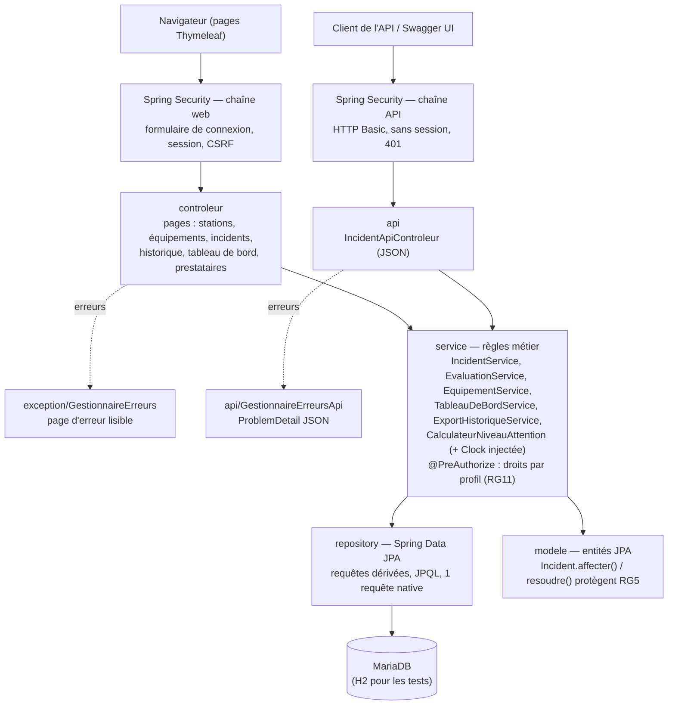

# Journal — RAS · Rien À Signaler (ALTN72, 2026-27)

**Groupe :** Noham BOULANOUAR (projet réalisé seule)

RAS est une application de supervision des équipements d'un réseau de transport (ascenseurs, escaliers mécaniques, portiques, distributeurs, écrans). Un agent déclare les pannes. Le responsable d'exploitation suit les incidents sur un tableau de bord coloré selon leur urgence, affecte un prestataire, clôt l'incident et évalue l'intervention.

---

## README

### Prérequis
- Java 21 (le projet compile en `release 21`)
- Maven 3.9 : le wrapper `mvnw` / `mvnw.cmd` est fourni, aucune installation n'est nécessaire
- MariaDB 11 ou plus récent (n'importe quelle base MariaDB/MySQL accessible)

### Initialiser la base
1. Ouvrir `db/create.sql`, remplacer `<mot_de_passe>` par un mot de passe de votre choix, puis exécuter le script en tant qu'administrateur (HeidiSQL ou `mariadb -u root -p < db/create.sql`). Il crée la base `ras` et un utilisateur dédié `ras`.
2. Donner ce mot de passe à l'application **sans l'écrire dans le code**, au choix :
   - variable d'environnement : `DB_PASSWORD=...` (et éventuellement `DB_URL`, `DB_USER`) ;
   - ou fichier `application-local.properties` à la racine du projet, ignoré par Git :
     `spring.datasource.password=...`

Les tables sont recréées et remplies de données de démonstration **à chaque démarrage** (`ddl-auto=create` + `config/DonneesDemo`). Il suffit donc de relancer l'application pour remettre la base dans son état initial, en quelques secondes. Les dates de ces données sont calculées par rapport à l'heure courante (« il y a 47 h », etc.).

### Lancer
```bash
./mvnw spring-boot:run          # Windows : mvnw.cmd spring-boot:run
```
Puis ouvrir http://localhost:8080.

### Comptes de test
| Profil | Identifiant | Mot de passe |
|---|---|---|
| Responsable d'exploitation | `c.martin` | `Resp2026!` |
| Agent de station | `t.durand` | `Agent2026!` |

Les mots de passe sont stockés hachés (BCrypt) en base.

### Données de démonstration utiles
- 3 stations, 8 équipements de 5 types, 3 prestataires.
- Incidents non affectés ouverts depuis **2 h, 47 h (vert), 48 h (orange), 71 h (orange), 72 h (rouge) et 120 h (rouge)** : ce sont les cas limites des seuils.
- 2 incidents affectés à Élévatec (« pris en charge », dont un ouvert depuis 80 h : il n'est **pas** rouge).
- 3 incidents résolus : un évalué (Portisys, 4/5), un résolu par Élévatec et pas encore évalué, un résolu sans prestataire (non évaluable).

### Adresses utiles
- Application : http://localhost:8080 (redirige vers la page de connexion)
- Documentation de l'API (Swagger UI) : http://localhost:8080/swagger-ui/index.html, après connexion. Dans Swagger, le bouton *Authorize* accepte les mêmes identifiants (HTTP Basic).
- API : `http://localhost:8080/api/incidents`

### Application déployée
Non déployée : voir les limites ci-dessous.

### Limites connues
- **Pas de déploiement en ligne** (§7.9) : faute de temps, l'application n'a pas été mise sur un serveur. Elle est prête à l'être : le port (`PORT`) et la base (`DB_URL`, `DB_USER`, `DB_PASSWORD`) se configurent par variables d'environnement.
- La base est recréée à chaque démarrage, ce qui convient à une démonstration mais pas à une production. Il faudrait passer à `ddl-auto=validate` et à des migrations Flyway.
- La création d'équipements existe dans le service (`EquipementService.creer`, avec référence unique) mais n'a pas d'écran : le parc est fixé par les données de démonstration.

---

## ARCHITECTURE

- **Dépôt :** https://github.com/NohamBoulanouar/ras
- **Pile :** Java 21, Spring Boot 4.1 (Web MVC, Data JPA, Security, Validation), Thymeleaf, MariaDB (H2 en mémoire pour les tests), springdoc-openapi (Swagger), Apache Commons CSV, JUnit 5, JaCoCo, GitHub Actions.

### Schéma



### Packages
| Package | Rôle |
|---|---|
| `modele` | Entités JPA et énumérations. `Incident` porte ses propres invariants : `affecter()` et `resoudre()` refusent les transitions interdites. |
| `repository` | Accès aux données (Spring Data JPA). |
| `service` | Toutes les règles de gestion RG1 à RG10 et les droits (RG11, `@PreAuthorize`). |
| `controleur` | Pages web : traduisent une requête HTTP en appel de service puis choisissent la vue. Aucune règle métier. Sous-packages `formulaire` (objets validés des formulaires) et `vue` (mise en forme des durées). |
| `api` | API REST, DTO et traduction des erreurs en JSON. |
| `exception` | Exceptions métier et leur traduction en pages d'erreur. |
| `securite` | Chargement des utilisateurs depuis la base, hachage BCrypt, chaînes de sécurité. |
| `config` | Horloge (`Clock`), documentation OpenAPI, données de démonstration. |

---

## TESTS

- **Commande :** `./mvnw verify`. Elle lance 61 tests sur une base H2 en mémoire, donc sans MariaDB, puis mesure la couverture avec JaCoCo. Le build échoue sous **80 % des lignes couvertes**. Couverture actuelle : environ 89 % des lignes et 83 % des branches. Le rapport se trouve dans `target/site/jacoco/index.html`.
- **Intégration continue :** GitHub Actions lance `mvnw verify` à chaque push et publie le rapport de couverture.

### Stratégie (pyramide de tests)
| Niveau | Classes | Ce qui est vérifié |
|---|---|---|
| Unitaires, sans Spring | `CalculateurNiveauAttentionTest`, `IncidentTest` | Seuils au cas limite près, grâce à une horloge figée (`Clock.fixed`) ; transitions interdites du modèle. |
| Services avec Spring et H2 | `IncidentServiceTest`, `EvaluationServiceTest`, `EquipementServiceTest`, `TableauDeBordServiceTest` | Règles RG1 à RG9, atomicité des opérations, droits par profil (`@WithMockUser`). |
| Repositories (`@DataJpaTest`) | `IncidentRepositoryTest` | Requêtes dérivées, JPQL et native ; tris de RG7 ; note moyenne. |
| Web (MockMvc) | `EquipementControleurTest`, `IncidentControleurTest`, `HistoriqueControleurTest`, `TableauDeBordControleurTest` | Redirection vers la connexion, rendu des pages, validation des formulaires, 403 sur une requête d'agent forgée, 404 lisible, export CSV. |
| API (MockMvc + HTTP Basic) | `IncidentApiControleurTest` | Codes 200, 201, 400, 401, 403, 404, 409 ; documentation OpenAPI. |

### Comportements suggérés au §7.8
| Comportement | Test |
|---|---|
| Non affecté depuis 47 h → vert | `CalculateurNiveauAttentionTest.ouvertDepuis47hEstVert` |
| À partir de 48 h → orange | `ouvertDepuis48hEstOrange` (et `ouvertDepuis71hEstOrange`) |
| À partir de 72 h → rouge | `ouvertDepuis72hEstRouge` |
| Un incident affecté a un état distinct | `incidentAffecteEstPrisEnCharge` (affecté depuis 100 h : pris en charge, pas rouge) |
| Un incident résolu n'apparaît plus parmi les actifs | `TableauDeBordServiceTest.unIncidentResoluNApparaitPlusParmiLesIncidentsActifs`, `IncidentRepositoryTest.lesIncidentsActifsExcluentLesResolus` |
| L'historique est ordonné du plus récent au plus ancien | `IncidentServiceTest.lHistoriqueEstOrdonneDuPlusRecentAuPlusAncien`, `IncidentRepositoryTest.lHistoriqueEstTrieParDateDeResolutionDecroissante` |
| Un incident inexistant produit la réponse prévue | `IncidentApiControleurTest.laDemandeDUnIncidentInexistantRenvoieUn404Explicite` (API) et `IncidentControleurTest.unIncidentInexistantAfficheUnePageIntrouvable` (page) |

### Non couvert, ou couvert partiellement
- Le parcours dans un vrai navigateur (JavaScript, rendu visuel) n'est pas testé automatiquement : il a été vérifié à la main.
- Les tests tournent sur H2 en mode MariaDB, pas sur MariaDB elle-même. Testcontainers le permettrait, mais il faut Docker sur chaque poste et dans la CI.
- La page de connexion elle-même (formulaire Spring Security) n'a pas de test dédié.

---

## CHOIX TECHNIQUES

### Profils et droits par profil (§5.6)
Les deux profils sont le **responsable d'exploitation**, qui pilote, et l'**agent de station**, qui constate et signale sur le terrain.

| N° | Fonctionnalité | Responsable d'exploitation | Agent de station |
|---|---|---|---|
| F2–F3 | Consulter équipements et fiches | Accès complet | Accès complet |
| F4 | Déclarer un incident | Accès complet | Accès complet |
| F5–F6 | Consulter / modifier un incident | Accès complet (modifie la description tant que l'incident n'est pas résolu) | Lecture seule |
| F7 | Affecter ou réaffecter un prestataire | Accès complet | Interdit |
| F8 | Déclarer un incident résolu | Accès complet | Interdit |
| F9 | Consulter l'historique | Accès complet, avec export CSV | Lecture seule, sans export |
| F10 | Évaluer un prestataire | Accès complet | Interdit |
| F11 | Tableau de bord | Accès complet | Interdit |
| F12 | API REST | Consultation et toutes les modifications | Consultation et déclaration |

**Où sont appliquées les restrictions (RG11) :**
- d'abord **dans les services**, avec `@PreAuthorize("hasRole('RESPONSABLE')")`. La règle s'applique donc quel que soit le point d'entrée (page, API, appel futur) ;
- ensuite, en complément, dans la configuration de sécurité pour `/tableau-de-bord`.

Masquer les boutons dans les pages n'est qu'un confort d'affichage. Le test `lAgentNePeutPasResoudreMemeEnEnvoyantLaRequeteALaMain` envoie la requête « à la main » avec le compte agent et obtient un 403.

**F6 : ce qui est modifiable.** Seule la **description** est modifiable, par le responsable, tant que l'incident n'est pas résolu :
- l'équipement et la date d'ouverture sont des faits constatés ; les changer fausserait la durée et donc l'indicateur d'urgence ;
- le prestataire et la résolution ont leurs propres actions (F7, F8) avec leurs règles ;
- un incident résolu est figé, car il fait partie de l'historique.

**Le statut d'un incident est déduit, pas stocké (RG2).** Il est calculé à partir de `prestataire` et de `dateResolution` (`estAffecte()`, `estResolu()`). Un état incohérent du type « statut = résolu sans date de résolution » est donc impossible. De même, le niveau d'attention n'est **jamais enregistré** : `CalculateurNiveauAttention` le calcule à chaque affichage à partir de l'horloge.

**Un incident peut être résolu sans prestataire** (panne réglée par l'équipe de station), mais il n'est alors pas évaluable (RG8). La page l'indique avant de confirmer la résolution.

### Exceptions
- Exceptions personnalisées, avec des messages en français : `RessourceIntrouvableException` (élément inexistant) et `RegleMetierException` (transition ou opération interdite). Ce sont des exceptions non vérifiées, pour ne pas polluer les signatures.
- **Choix de `@ControllerAdvice` plutôt que `ResponseStatusException`.** Avec `ResponseStatusException`, les services devraient connaître les codes HTTP. Or ils sont appelés à la fois par des pages et par une API, qui ne présentent pas l'erreur de la même façon. Avec `@ControllerAdvice` :
  - les services lèvent une exception métier, sans rien savoir du web ;
  - **deux** gestionnaires, un par canal, traduisent cette exception au même endroit :
    - `GestionnaireErreurs` (pages) : 404 ou 400, avec une page lisible ;
    - `GestionnaireErreursApi` (API) : un `ProblemDetail` JSON standard (RFC 9457), avec 404 pour un élément introuvable, 409 pour une transition interdite (par exemple résoudre deux fois), 400 pour des données invalides et 403 pour un accès refusé.
- Les erreurs de saisie des formulaires sont gérées par Bean Validation (`@Valid` + `BindingResult`). Le formulaire est réaffiché avec un message sous le champ.
- Aucune trace technique n'est affichée : `server.error.include-stacktrace=never`, plus des pages `error/403.html`, `error/404.html` et `erreur.html`.
- **`ResponseEntity`** n'est utilisé que là où il apporte quelque chose : `POST /api/incidents`, qui renvoie **201 Created** avec l'en-tête `Location`, et l'export CSV, qui a besoin des en-têtes `Content-Disposition` et `Content-Type`. Partout ailleurs, la méthode renvoie directement le DTO (200 par défaut).

### Principes SOLID
**Appliqués :**
- **S — Responsabilité unique.**
  - `CalculateurNiveauAttention` ne fait qu'une chose : déduire le niveau d'un incident. Les seuils de 48 h et 72 h y sont définis une seule fois (`SEUIL_ORANGE`, `SEUIL_ROUGE`). Le tableau de bord, la page de détail et l'API l'utilisent tous.
  - De même, `ExportHistoriqueService` ne s'occupe que du format CSV, `TableauDeBordService` du tri, du filtrage et des indicateurs, et `FormatDuree` de l'affichage d'une durée.
  - Concrètement, changer un seuil ou ajouter une colonne au CSV ne touche qu'une classe.
- **D — Inversion des dépendances.**
  - Les services reçoivent leurs dépendances par le constructeur : des abstractions (interfaces `…Repository`, `Clock`) plutôt que des implémentations.
  - L'effet concret le plus visible est **l'horloge injectée** : en production, c'est l'horloge système ; dans les tests, une horloge figée. On teste ainsi « 47 h → vert, 48 h → orange » de façon exacte et reproductible, sans attendre ni dépendre de l'heure du lancement.

**Écartés, et pourquoi :**
- **O — Ouvert/fermé.** Les niveaux d'attention forment une liste fermée fixée par le sujet (vert, orange, rouge, pris en charge). Introduire une hiérarchie de « stratégies de niveau » ajouterait des classes sans besoin réel : un `enum` et une méthode lisible suffisent.
- **L — Substitution de Liskov.** Le projet n'a pas de hiérarchie d'héritage métier. Les seules sous-classes sont les deux exceptions, qui étendent `RuntimeException` sans en changer le contrat. Il n'y a donc rien à substituer.
- **I — Ségrégation des interfaces.** Les seules interfaces écrites sont les repositories. Chacun est déjà propre à une entité et ne déclare que les requêtes dont son service a besoin. Les découper davantage n'aurait aucun effet.

### Requête SQL native
- **Où :** `IncidentRepository.compterIncidentsActifs()`, c'est-à-dire `SELECT COUNT(*) FROM incident WHERE date_resolution IS NULL`. Elle alimente l'indicateur « incidents actifs » du tableau de bord.
- **Analyse critique :**
  - *Avantage* : la base fait le comptage, sans charger aucune entité.
  - *Inconvénients* :
    - la requête dépend des noms **physiques** (`incident`, `date_resolution`), donc d'une stratégie de nommage d'Hibernate. Si on renomme le champ `dateResolution` en Java, elle casse **à l'exécution**, pas à la compilation ;
    - elle contourne le modèle objet ;
    - elle n'est pas portable si on change de SGBD avec une syntaxe différente.
  - Ici, une requête JPQL `SELECT COUNT(i) FROM Incident i WHERE i.dateResolution IS NULL` donnerait le même résultat, avec les mêmes performances, vérifiée au démarrage et indépendante du schéma physique. C'est elle que je garderais dans un vrai projet. Le test `laRequeteNativeCompteLesMemesIncidentsActifsQueLaRequeteJpql` protège au moins contre une divergence entre les deux.
- Les autres requêtes sont **dérivées du nom des méthodes** (`findByEquipementIdOrderByDateOuvertureDesc`, `existsByReference`, `findByLogin`, etc.) ou en **JPQL** (incidents actifs, historique trié, note moyenne d'un prestataire).

### Usages de `@Transactional`
Uniquement sur les méthodes de service qui **écrivent**. Les lectures n'en ont pas besoin.

| Méthode | Pourquoi |
|---|---|
| `IncidentService.declarer` | Crée l'incident **et** passe l'équipement hors service : les deux ou aucun (RG10). |
| `IncidentService.resoudre` | Enregistre la résolution **et** remet l'équipement en service s'il n'a plus aucune autre panne : la vérification et les écritures forment un tout. |
| `IncidentService.affecter`, `modifierDescription` | Charge l'incident, vérifie la règle, puis modifie. Les modifications de l'entité chargée sont enregistrées automatiquement à la fin de la transaction (*dirty checking*) : pas besoin de `save()`. |
| `EvaluationService.evaluer` | Les vérifications (incident résolu, avec prestataire, pas encore évalué) et l'insertion doivent porter sur le même état de la base. |
| `EquipementService.creer` | Même raisonnement : vérifier l'unicité de la référence puis insérer. La contrainte `unique` en base reste le dernier rempart. |

Si une `RegleMetierException` est levée, la transaction est annulée : aucune donnée n'est à moitié modifiée.

### Autres choix
- **Thymeleaf plutôt qu'Angular :** j'ai fait le projet seule, sur 4 séances. J'ai choisi la technologie vue en cours pour consacrer mon temps aux règles métier et aux tests.
- **Sécurité :**
  - mots de passe hachés avec BCrypt ;
  - aucun secret dans le dépôt : variables d'environnement, ou `application-local.properties` ignoré par Git ;
  - **deux chaînes de sécurité** : formulaire, session et CSRF pour les pages ; HTTP Basic, sans session, avec une réponse 401 pour l'API.
- **Identifiants en français**, dans le vocabulaire du domaine (incident, prestataire, résoudre…), pour une seule langue cohérente.

---

## LOT ALPHA

### Fonctionnalité transverse 1 — Piste 7 : qualité renforcée
- **Besoin :** détecter toute régression dès qu'elle apparaît, et pouvoir prouver ce qui est testé.
- **Périmètre réalisé :**
  - intégration continue GitHub Actions dès la première séance : `mvnw verify` à chaque push ;
  - tests d'intégration des contrôleurs (MockMvc) et des repositories (`@DataJpaTest`) ;
  - mesure de la couverture avec JaCoCo, avec un **seuil bloquant** de 80 % des lignes et un rapport publié comme artefact de la CI ;
  - stratégie de validation à deux étages : Bean Validation pour la forme des saisies, services et modèle pour les règles métier.
- **Choix et essais :**
  - horloge injectée pour rendre les seuils testables à la minute près ;
  - tests de services sur la vraie configuration Spring avec H2, plutôt que des mocks, pour vérifier aussi les requêtes et les transactions ;
  - `@Transactional` sur les classes de test, pour que chaque test reparte des données de démonstration.
- **Ce qui fonctionne :** 61 tests verts, environ 89 % des lignes couvertes, CI verte.
- **Difficultés :** les tests web tombaient sur la page de connexion. Il a fallu simuler l'utilisateur connecté avec `SecurityMockMvcRequestPostProcessors.user(...)` (pages) et `httpBasic(...)` (API).
- **Reste à faire :** Testcontainers pour tester sur une vraie MariaDB.

### Fonctionnalité transverse 2 — Piste 9 : export de l'historique en CSV
- **Besoin :** le responsable veut retravailler l'historique des interventions (délais, prestataires, notes) dans un tableur.
- **Périmètre réalisé :** un bouton « Exporter en CSV » sur la page Historique, réservé au responsable (403 pour l'agent, y compris par l'URL directe). Le fichier `historique-incidents.csv` contient :
  - l'incident, la station, l'équipement et le type ;
  - la description, les dates d'ouverture et de résolution, la durée en heures ;
  - le prestataire et la note.
- **Choix :**
  - Apache Commons CSV plutôt qu'une concaténation à la main, qui gère correctement les guillemets, les points-virgules et les retours à la ligne dans les descriptions ;
  - séparateur `;` et marque UTF-8 (BOM), pour qu'Excel en français ouvre le fichier directement avec les bons accents ;
  - la génération est dans un service dédié (`ExportHistoriqueService`), le contrôleur ne fait que fixer les en-têtes HTTP.
- **Ce qui fonctionne :** l'export est testé (contenu, en-têtes, refus pour l'agent).
- **Limites :** l'export porte sur tout l'historique, sans filtre de période ; il n'y a pas d'import.

---

## BILAN

- **Contribution :** projet réalisé seule. Le travail a avancé par couches :
  - séance 1 : initialisation, modèle (6 entités, statut déduit), repositories, données de démonstration, intégration continue ;
  - séance 2 : calculateur de niveau d'attention, méthodes métier `Incident.affecter()` / `resoudre()` et services `IncidentService`, avec leurs tests ;
  - séance 3 : `EvaluationService`, `EquipementService`, sécurité (connexion, droits `@PreAuthorize`), gestion des erreurs, premiers écrans ;
  - fin du projet : écrans de détail, d'historique et de tableau de bord, API REST, export CSV, tests web et repository, JaCoCo et ce journal.
- **Plus grande difficulté :** avancer seule à un rythme suffisant. J'ai passé beaucoup de temps à bien comprendre les tests et la couche service (par exemple pourquoi `estAffecte()` ne convient pas pour savoir si un incident résolu avait un prestataire), et j'ai pris du retard sur les écrans. Je l'ai surmonté en priorisant le socle (règles métier testées) avant l'interface.
- **Non réalisé :**
  - le déploiement en ligne (§7.9), par manque de temps ;
  - un écran de création d'équipement ;
  - les tests sur une vraie MariaDB.
- **Trois points à retenir :**
  1. Mettre les règles métier dans le modèle et les services, jamais dans les contrôleurs : c'est ce qui permet de servir à la fois des pages et une API sans dupliquer le code, et de tout tester sans navigateur.
  2. Ce qui dépend du temps doit recevoir le temps (`Clock`) plutôt que d'aller le chercher (`LocalDateTime.now()`) : sinon c'est impossible à tester proprement.
  3. Une restriction de droits se vérifie côté serveur : cacher un bouton ne protège rien.
